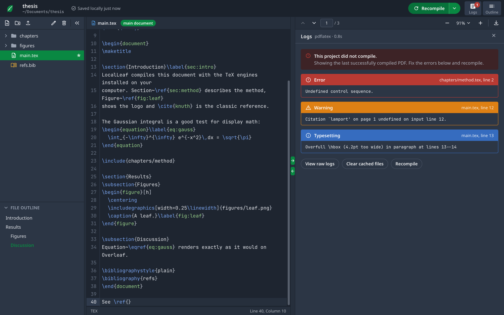
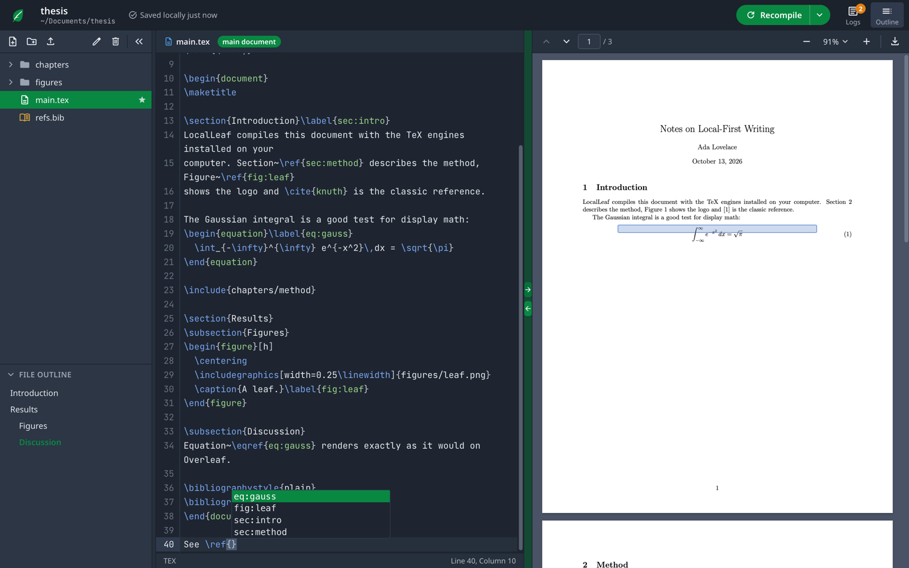
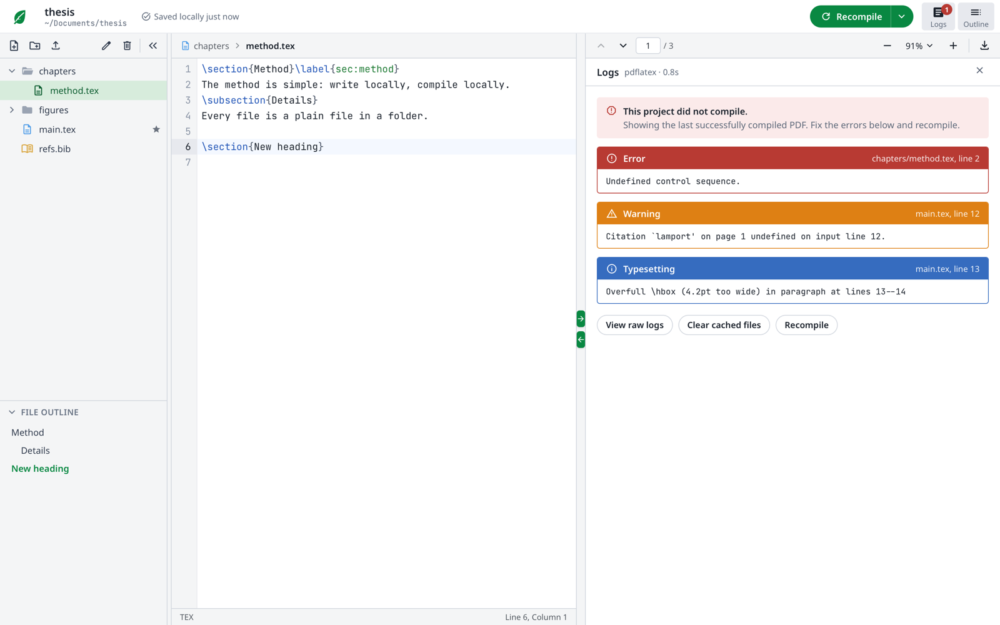
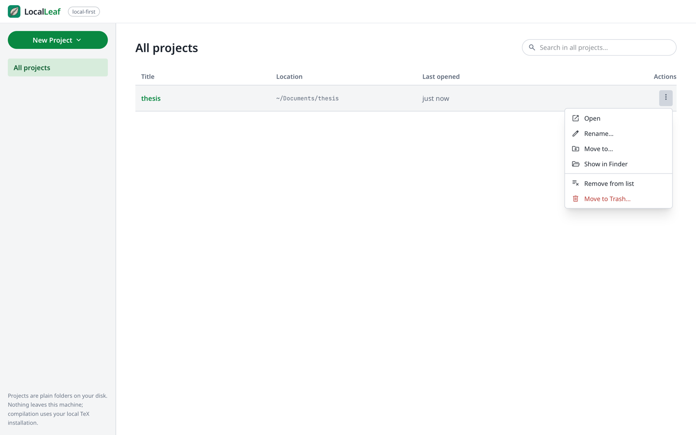

<div align="center">


# LocalLeaf

**A local-first LaTeX editor with an Overleaf-style interface.**
Native Rust + Tauri, compiles with the TeX engines already on your computer, and doubles as an MCP server for AI agents.

[Download](https://github.com/leoaliperti/LocalLeaf/releases/latest) ·
[Features](#features) ·
[AI agents (MCP)](docs/MCP.md) ·
[Build from source](#building-from-source) ·
[Architecture](docs/ARCHITECTURE.md)


</div>

## Why LocalLeaf

- **Your files stay yours.** A project is a plain folder on disk. No account, no upload, no sync service: works offline, on a plane, under NDA.
- **The familiar workflow.** File tree, outline, code editor, PDF preview, green *Recompile* button, clickable logs: if you know Overleaf, you already know LocalLeaf.
- **Real TeX, not a reimplementation.** LocalLeaf drives `pdflatex`, `xelatex`, `lualatex` or `tectonic` from your own installation, runs `bibtex`/`biber` and reruns LaTeX like `latexmk`, so documents compile the same way they do on Overleaf.
- **Agent-ready.** The app (and the standalone `texcraft-core` CLI) speaks the [Model Context Protocol](https://modelcontextprotocol.io): an AI agent can compile, read and edit the project you have open, and you watch the changes arrive live.

## Features

| | |
|---|---|
| **Editor** | CodeMirror 6 with LaTeX highlighting, autocompletion for commands, environments, `\ref` labels, `\cite` keys (from your `.bib` files), `\includegraphics` and `\input` paths; Vim and Emacs keybindings; five editor themes; JetBrains Mono. |
| **PDF preview** | PDF.js with continuous scroll, zoom, fit width/page, page navigation, selectable text and download. |
| **SyncTeX** | Jump from the cursor to the PDF and back (arrows on the divider, double-click in the PDF, or <kbd>⌥⌘→</kbd>/<kbd>⌥⌘←</kbd>). |
| **Logs** | Errors, warnings and bad boxes as clickable cards that open the right file at the right line, with hints for common local issues (wrong engine for `fontspec`, missing fonts, files renamed by the OS). |
| **Compile options** | Engine choice, auto-compile, fast draft mode, stop-on-first-error, recompile from scratch. The engine a preamble needs is detected on first open. |
| **Projects** | Dashboard with search; per-project menu to open, rename, move (also across disks), reveal in Finder/Explorer, or move to the Trash. Per-project settings (main document, compiler, options) are stored in the project itself. |
| **Files** | New file/folder, upload (or drag from Finder), rename, delete, drag-and-drop between folders, file outline of `\section`s. |
| **Menu bar** | Native menus with standard shortcuts: File, Edit, **Insert** (sections, lists, figures, tables, equations, citations…), View (layouts, panels, font size, theme), Project (compile, engine, SyncTeX, word count). |
| **Local-first** | Autosave to disk (also right before quitting), live reload when files change outside the app (another editor, `git pull`, an AI agent), and a prompt instead of a silent overwrite when a file changes on disk while you have unsaved edits. |
| **Accessibility** | Keyboard-navigable menus and dialogs, light and dark themes, adjustable editor font and size, optional system spell checking. |

<table>
  <tr>
    <td></td>
    <td></td>
  </tr>
  <tr>
    <td></td>
    <td></td>
  </tr>
</table>

## Installation

Download the package for your system from the [latest release](https://github.com/leoaliperti/LocalLeaf/releases/latest).

| Platform | Package |
|---|---|
| macOS 11+ (Apple Silicon and Intel) | `LocalLeaf_<version>_universal.dmg` |
| Windows 10/11 x64 | `LocalLeaf_<version>_x64-setup.exe` (or `.msi`) |
| Linux x64 | `.AppImage`, `.deb` or `.rpm` |
| Command-line MCP server only | `texcraft-core-<platform>.tar.gz` / `.zip` |

> [!NOTE]
> The builds are not code-signed yet, so the OS will warn you the first time.
> **macOS:** right-click LocalLeaf in *Applications* → *Open* → *Open* (or run `xattr -dr com.apple.quarantine /Applications/LocalLeaf.app`).
> **Windows:** in the SmartScreen dialog choose *More info* → *Run anyway*.
> **Linux AppImage:** `chmod +x LocalLeaf_*.AppImage` before running it.

### You also need a TeX distribution

LocalLeaf does not bundle TeX; it uses the one on your system.

| System | Recommended |
|---|---|
| macOS | [MacTeX](https://tug.org/mactex/) (full), or `brew install --cask mactex-no-gui` |
| Windows | [TeX Live](https://tug.org/texlive/windows.html) or [MiKTeX](https://miktex.org/) |
| Linux | `sudo apt install texlive-full` (Debian/Ubuntu) or `sudo dnf install texlive-scheme-full` (Fedora) |
| Any | [Tectonic](https://tectonic-typesetting.github.io/) (`brew install tectonic`), a self-contained engine that downloads packages on demand |

SyncTeX navigation uses the `synctex` command that ships with TeX Live and MiKTeX. *Settings → Compiler* shows which engines LocalLeaf found.

> [!TIP]
> **Coming from Overleaf?** Download your project as a ZIP, unzip it and open the folder. If it doesn't compile, check *Project → Compiler* (Overleaf projects using `fontspec` usually need XeLaTeX or LuaLaTeX) and that the fonts the document uses are installed. The logs explain both cases.

## Usage

1. **New Project** creates a folder with a `main.tex`; **Open Folder…** (<kbd>⌘O</kbd>) opens any existing LaTeX project.
2. Write in the editor: files save automatically to disk.
3. Press **Recompile** (<kbd>⌘↵</kbd>, or <kbd>Ctrl+Enter</kbd> on Windows/Linux). Build output goes to a hidden `.texcraft/build/` folder inside the project, so your sources stay clean (add `.texcraft/` to your `.gitignore`).
4. Click an error in **Logs** to jump to it; use the SyncTeX arrows to move between code and PDF.

The main document is detected automatically (`main.tex`, or the first root file with `\documentclass`); change it with *Project → Set Current File as Main Document* or in *Settings → Compiler*. These per-project choices are saved in `.texcraft/settings.json`, where the MCP server reads them too. The full shortcut list is in *Help → Keyboard Shortcuts*.

<details>
<summary><b>Keyboard shortcuts</b> (macOS; use Ctrl instead of ⌘ elsewhere)</summary>

| Action | Shortcut |
|---|---|
| Recompile / Save and recompile | <kbd>⌘↵</kbd> / <kbd>⌘S</kbd> |
| Recompile from scratch | <kbd>⇧⌘↵</kbd> |
| Go to location in PDF / in code | <kbd>⌥⌘→</kbd> / <kbd>⌥⌘←</kbd> |
| Bold / Italic / Toggle comment | <kbd>⌘B</kbd> / <kbd>⌘I</kbd> / <kbd>⌘/</kbd> |
| Find / Find and replace / Go to line | <kbd>⌘F</kbd> / <kbd>⌥⌘F</kbd> / <kbd>⌘L</kbd> |
| Insert section / subsection / equation / link | <kbd>⌥⌘1</kbd> / <kbd>⌥⌘2</kbd> / <kbd>⌥⌘E</kbd> / <kbd>⌘K</kbd> |
| Layout: editor & PDF / editor / PDF | <kbd>⌘1</kbd> / <kbd>⌘2</kbd> / <kbd>⌘3</kbd> |
| File tree / Outline / Logs | <kbd>⌥⌘B</kbd> / <kbd>⇧⌘O</kbd> / <kbd>⇧⌘L</kbd> |
| Editor font size | <kbd>⌘=</kbd> / <kbd>⌘-</kbd> / <kbd>⌘0</kbd> |
| New file / New project / Open folder | <kbd>⌘N</kbd> / <kbd>⇧⌘N</kbd> / <kbd>⌘O</kbd> |
| Settings | <kbd>⌘,</kbd> |

</details>

## AI agents (MCP)

LocalLeaf exposes a project to AI agents through the Model Context Protocol, with four tools: `compile_tex`, `read_project_file`, `write_project_file` and `list_available_engines`. The agent works on the same files and settings as the editor: `compile_tex` with no arguments builds your main document with the compiler you chose, and its compilations take turns with yours. Files inside `.git/` are off limits. With Claude Code, for example:

```sh
claude mcp add localleaf -- /Applications/LocalLeaf.app/Contents/MacOS/localleaf --mcp --root ~/Documents/thesis
```

The exact command for the open project is in *Help → Connect an AI Agent*. Edits made by the agent appear in the editor immediately, and the PDF refreshes when the agent recompiles. See **[docs/MCP.md](docs/MCP.md)** for the tool reference and setup for other clients.

## Building from source

Requirements: [Rust](https://rustup.rs/) (stable), [Node.js](https://nodejs.org/) 20+, a TeX distribution, and the [Tauri prerequisites](https://v2.tauri.app/start/prerequisites/) for your OS (Xcode Command Line Tools on macOS, WebView2 and MSVC on Windows, `webkit2gtk-4.1` on Linux).

```sh
git clone https://github.com/leoaliperti/LocalLeaf.git
cd LocalLeaf

# Standalone CLI / MCP server
cargo build --release -p texcraft-core
./target/release/texcraft-core            # system check: lists detected TeX engines
./target/release/texcraft-core --mcp      # MCP server on stdio for the current folder

# Desktop app
cd desktop
npm install
npm run app                               # development (tauri dev)
npm run app -- -- ~/Documents/thesis      # development, opening a project directly
npm run app:build                         # installers in target/release/bundle/
npx tauri build --target universal-apple-darwin   # universal macOS build
```

### Tests

```sh
cargo test --workspace                    # log parser, project sandbox, SyncTeX, folder moves
cd desktop && npm test                    # LaTeX source analysis
npm run typecheck
npm run dev &                             # UI smoke test in WebKit (bundled fixture project),
node e2e/ui-smoke.mjs                     # screenshots in desktop/e2e/screenshots
```

The [release workflow](.github/workflows/release.yml) builds and attaches the macOS, Windows and Linux packages whenever a GitHub release is published.

## Project layout

```
LocalLeaf/
├── src/                    texcraft-core: library + CLI
│   ├── compiler.rs         runs TeX engines, bibtex/biber, reruns; parses logs
│   ├── project.rs          sandboxed file access inside a project folder
│   ├── synctex.rs          source ↔ PDF lookups via the synctex CLI
│   └── mcp_server.rs       MCP server (JSON-RPC 2.0 over stdio)
├── desktop/                LocalLeaf desktop app
│   ├── src/                Vue 3 + TypeScript + Tailwind UI (CodeMirror 6, PDF.js)
│   ├── src-tauri/          Tauri v2 backend: IPC commands, menu bar, file watcher
│   └── e2e/ui-smoke.mjs    WebKit UI smoke test
├── examples/smoke.rs       compiles a project and exercises SyncTeX
└── docs/                   MCP reference, architecture, screenshots
```

More detail in [docs/ARCHITECTURE.md](docs/ARCHITECTURE.md).

## Roadmap

Planned work, including git versioning in the interface, a guided installer for TeX and its packages, and installing missing packages straight from the logs, is listed in [ROADMAP.md](ROADMAP.md).

## Limitations

LocalLeaf is a single-user, local editor. It does not have Overleaf's real-time collaboration, track changes, comments, project history or rich-text (visual) editor. Use git for history and sharing. Windows and Linux builds are produced by CI and have had less hands-on testing than macOS; please [open an issue](https://github.com/leoaliperti/LocalLeaf/issues) if something doesn't work.

## Contributing

Issues and pull requests are welcome. See [CONTRIBUTING.md](CONTRIBUTING.md).

## License and credits

LocalLeaf is released under the [MIT License](LICENSE).

The interface is inspired by [Overleaf](https://www.overleaf.com). LocalLeaf is an independent project, not affiliated with or endorsed by Overleaf. Built with [Tauri](https://tauri.app), [Vue](https://vuejs.org), [CodeMirror](https://codemirror.net), [PDF.js](https://mozilla.github.io/pdf.js/) (its text-layer stylesheet is included under the Apache-2.0 license), [Material Symbols](https://fonts.google.com/icons) and [JetBrains Mono](https://www.jetbrains.com/lp/mono/).
