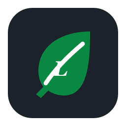
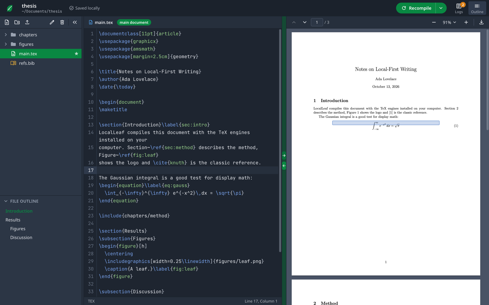

A fork of [LocalLeaf](https://github.com/leoaliperti/LocalLeaf) where I fix some bugs and continue maintaining it for my personal use.

The original project appears to be vibe-coded, well so is my maintaining, but it works well enough for me so there's that I guess.

---

<div align="center">



# LocalLeaf

[](https://m8ven.ai/mcp/leoaliperti-localleaf-1osh5g?s=readme)

**A local-first LaTeX editor with an Overleaf-style interface.**
Native Rust + Tauri, compiles with the TeX engines already on your computer, and doubles as an MCP server for AI agents.

[Download](https://github.com/leoaliperti/LocalLeaf/releases/latest) ·
[Features](#features) ·
[AI agents (MCP)](docs/MCP.md) ·
[Build from source](#building-from-source) ·
[Architecture](docs/ARCHITECTURE.md)



</div>

<details>
<summary><b>Keyboard shortcuts</b> (macOS; use Ctrl instead of ⌘ elsewhere)</summary>

| Action | Shortcut |
|---|---|
| Recompile / Save and recompile | <kbd>⌘↵</kbd> / <kbd>⌘S</kbd> |
| Recompile from scratch | <kbd>⇧⌘↵</kbd> |
| Go to location in PDF / in code | <kbd>⌥⌘→</kbd> / <kbd>⌥⌘←</kbd> |
| Bold / Italic / Toggle comment | <kbd>⌘B</kbd> / <kbd>⌘I</kbd> / <kbd>⌘/</kbd> |
| Find / Find and replace / Go to line | <kbd>⌘F</kbd> / <kbd>⌥⌘F</kbd> / <kbd>⌘L</kbd> |
| Insert section / subsection / equation / link | <kbd>⌥⌘1</kbd> / <kbd>⌥⌘2</kbd> / <kbd>⌥⌘E</kbd> / <kbd>⌘K</kbd> |
| Layout: editor & PDF / editor / PDF | <kbd>⌘1</kbd> / <kbd>⌘2</kbd> / <kbd>⌘3</kbd> |
| File tree / Outline / Logs | <kbd>⌥⌘B</kbd> / <kbd>⇧⌘O</kbd> / <kbd>⇧⌘L</kbd> |
| Editor font size | <kbd>⌘=</kbd> / <kbd>⌘-</kbd> / <kbd>⌘0</kbd> |
| New file / New project / Open folder | <kbd>⌘N</kbd> / <kbd>⇧⌘N</kbd> / <kbd>⌘O</kbd> |
| Settings | <kbd>⌘,</kbd> |

</details>

## AI agents (MCP)

LocalLeaf exposes a project to AI agents through the Model Context Protocol, with four tools: `compile_tex`, `read_project_file`, `write_project_file` and `list_available_engines`. The agent works on the same files and settings as the editor: `compile_tex` with no arguments builds your main document with the compiler you chose, and its compilations take turns with yours. Files inside `.git/` are off limits. With Claude Code, for example:

```sh
claude mcp add localleaf -- /Applications/LocalLeaf.app/Contents/MacOS/localleaf --mcp --root ~/Documents/thesis
```

The exact command for the open project is in *Help → Connect an AI Agent*. Edits made by the agent appear in the editor immediately, and the PDF refreshes when the agent recompiles. See **[docs/MCP.md](docs/MCP.md)** for the tool reference and setup for other clients.

## Project layout

```
LocalLeaf/
├── src/                    texcraft-core: library + CLI
│   ├── compiler.rs         runs TeX engines, bibtex/biber, reruns; parses logs
│   ├── project.rs          sandboxed file access inside a project folder
│   ├── synctex.rs          source ↔ PDF lookups via the synctex CLI
│   └── mcp_server.rs       MCP server (JSON-RPC 2.0 over stdio)
├── desktop/                LocalLeaf desktop app
│   ├── src/                Vue 3 + TypeScript + Tailwind UI (CodeMirror 6, PDF.js)
│   ├── src-tauri/          Tauri v2 backend: IPC commands, menu bar, file watcher
│   └── e2e/ui-smoke.mjs    WebKit UI smoke test
├── examples/smoke.rs       compiles a project and exercises SyncTeX
└── docs/                   MCP reference, architecture, screenshots
```

More detail in [docs/ARCHITECTURE.md](docs/ARCHITECTURE.md).


## License and credits

LocalLeaf is released under the [MIT License](LICENSE).

The interface is inspired by [Overleaf](https://www.overleaf.com). LocalLeaf is an independent project, not affiliated with or endorsed by Overleaf. Built with [Tauri](https://tauri.app), [Vue](https://vuejs.org), [CodeMirror](https://codemirror.net), [PDF.js](https://mozilla.github.io/pdf.js/) (its text-layer stylesheet is included under the Apache-2.0 license), [Material Symbols](https://fonts.google.com/icons) and [JetBrains Mono](https://www.jetbrains.com/lp/mono/).
